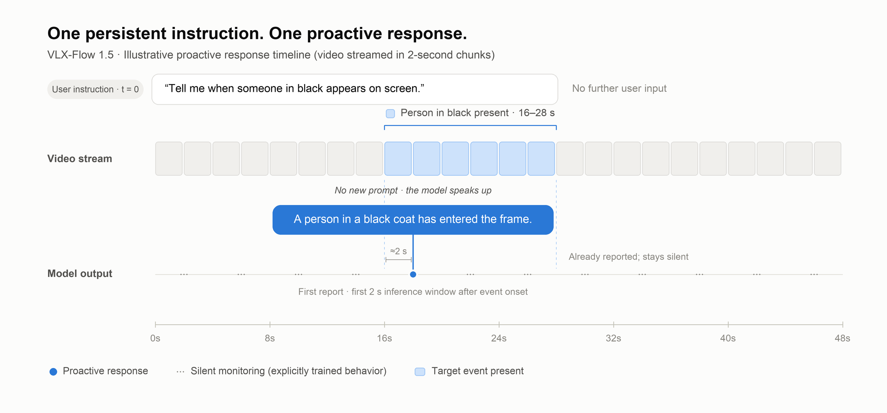
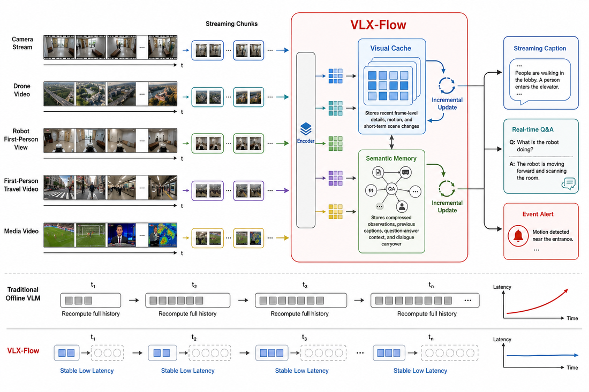
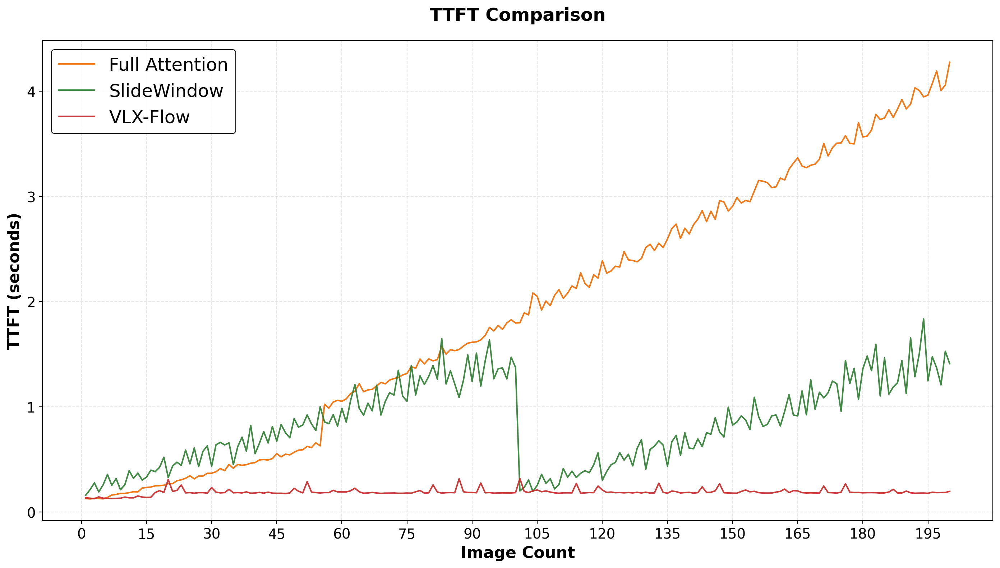
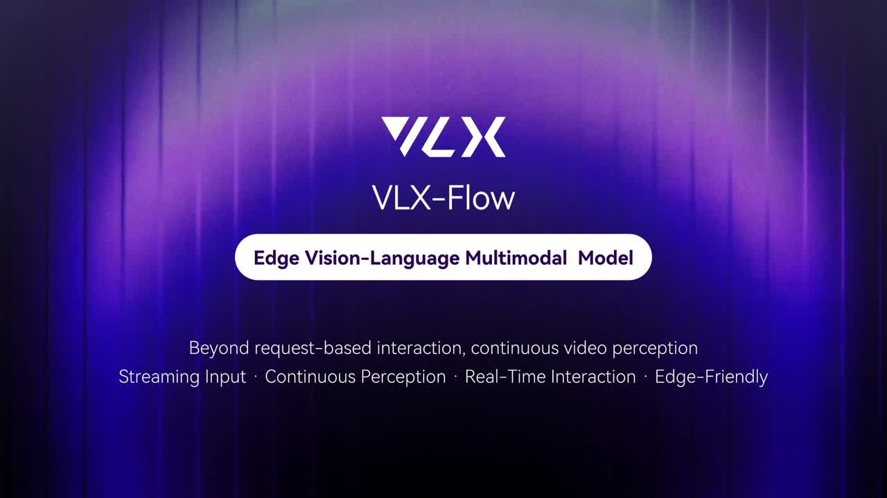

<a name="top"></a>

<p align="center">
  
</p>

<h1 align="center">VLX-Flow 1.5</h1>

<h3 align="center">Proactive Response Enhancement for On-Device Real-Time Streaming Video</h3>

<p align="center">
  English | <a href="README_zh.md">中文</a>
</p>

<p align="center">
  <a href="https://om-ai-lab.github.io/2026_11_01_vlx_flow_1_5_en.html">
    
  </a>
  <a href="https://om-agent.com">
    
  </a>
  <a href="https://x.com/OmAI_lab">
    
  </a>
  <a href="https://www.youtube.com/@OmAILab_global">
    
  </a>
  <a href="https://discord.gg/SEVNjyXPef">
    
  </a>
</p>

<p align="center">
  <a href="#highlights">Highlights</a> &nbsp;·&nbsp;
  <a href="#proactive-demo">Proactive Response</a> &nbsp;·&nbsp;
  <a href="#api-examples">API Notebooks</a> &nbsp;·&nbsp;
  <a href="#benchmarks">Benchmarks</a> &nbsp;·&nbsp;
  <a href="#architecture">Architecture</a> &nbsp;·&nbsp;
  <a href="#community">Community</a>
</p>

---

<a name="overview"></a>

## 🌊 Overview

VLX-Flow is a streaming multimodal model designed for on-device, real-time video understanding. Through **continuous video input, incremental state updates, and two-layer memory**, it supports proactive response, continuous description, and real-time question answering, providing ongoing semantic context for cameras, robots, and screen assistants.

**VLX-Flow 1.5 builds on the existing streaming architecture, strengthening event triggering and silence control under persistent instructions, description coherence, and visual grounding in QA.** Two-layer memory and Linear Attention are inherited foundations; this update focuses on the continuous interaction they support.

<a name="highlights"></a>

## ✨ What's New in 1.5

- **🔔 Stronger proactive response** — Observe under a persistent natural-language instruction, with improved event-triggered responses, return to silence, and control of repeated output.

- **🎬 More coherent continuous description** — Strengthen semantic continuity across chunks so descriptions follow scene changes with less fragmentation and repetition.

- **💬 Better visual grounding in real-time QA** — Answer from prior observations, expressing uncertainty or declining when evidence is insufficient.

- **⚡ Streaming inference with output on demand** — Build on incremental processing and state reuse, using silence control to reduce redundant generation.

<a name="proactive-demo"></a>

## 🔔 Proactive Response Example

> 💬 **Persistent instruction**
>
> “Let me know when someone wearing a black jacket appears.”

The model keeps observing the video, responds when the instruction condition is met, and then resumes observation for subsequent qualifying events.

<p align="center">
  
  <br>
  <sub>Illustrated interaction flow: one instruction carries through subsequent observation and event responses.</sub>
</p>

<a name="capabilities"></a>

## 🎯 Three Interaction Capabilities

### 🔔 Proactive Response

Once a user specifies an event of interest, the model combines the instruction, current visual evidence, and reply history to decide whether to keep observing, respond, or return to silence. Version 1.5 focuses on response timing and restrained output for task-driven camera observation and environmental alerts.

### 🎬 Continuous Description

The model describes scenes, subjects, and actions as video arrives, maintaining a timeline through semantic continuity across chunks. For example, “picking up a cup → walking to a table → putting it down” can form connected observation context for running commentary and follow-up questions.

### 💬 Real-Time Question Answering

Users can ask questions while a video plays or a camera runs, and the model answers from its maintained observation context. Version 1.5 strengthens visual grounding: if no boat has appeared, a question such as “Which way did that boat go?” should receive an explanation that no boat was observed, avoiding unsupported speculation.

<a name="api-examples"></a>

## 📓 Public API Notebooks

Run the online API with the included local MP4 samples. Start with the quickstart to learn the requests, then use the playground to explore the same capabilities interactively.

| Notebook | What it covers |
| --- | --- |
| [01 · API quickstart](examples/notebooks/01_api_quickstart.ipynb) | Upload a video, set instructions, receive streaming text, ask follow-up questions, close the session, and optionally run two sessions in parallel. |
| [02 · Interactive playground](examples/notebooks/02_interactive_playground.ipynb) | Preview video, adjust parameters, switch description/detection instructions, ask questions, and view two independent analysis streams. |

See [setup and run order](examples/README.md) and [how the playground works](examples/docs/interactive_playground.md). Notebook instructions are currently in Chinese. You need a platform API endpoint, access token, and model access; parallel mode uses two sessions and does not guarantee frame synchronization. Upload runs explicitly, and analysis starts only when you run the start cell or click Start.

<a name="benchmarks"></a>

## 📊 Evaluation Summary

Selected quality metrics for VLX-Flow 1.5 across three public benchmarks are shown below. Follow “Full comparison” to view the corresponding model comparison table, task breakdowns, and evaluation notes in the technical blog.

| Benchmark / task | Metric | VLX-Flow 1.5 | Detailed results |
| --- | --- | ---: | --- |
| 🎞️ StreamingBench Real-Time Visual | Overall | **85.00** | [Full comparison ↗](https://om-ai-lab.github.io/2026_11_01_vlx_flow_1_5_en.html#:~:text=Table%201.%20StreamingBench%20Real-Time%20Visual) |
| 🕒 OVO-Bench | Overall (macro average of three groups) | **70.51** | [Full comparison ↗](https://om-ai-lab.github.io/2026_11_01_vlx_flow_1_5_en.html#:~:text=Table%202.%20OVO-Bench) |
| 💬 TraceBench v1.1 · Real-time QA | QA accuracy | **76.5%** | [Full comparison ↗](https://om-ai-lab.github.io/2026_11_01_vlx_flow_1_5_en.html#:~:text=Table%203.%20TraceBench%20v1.1) |
| 🔔 TraceBench v1.1 · Proactive response | In-window accuracy | **21.1%** | [Full comparison ↗](https://om-ai-lab.github.io/2026_11_01_vlx_flow_1_5_en.html#:~:text=Table%203.%20TraceBench%20v1.1) |

StreamingBench and OVO-Bench use streaming evaluation aligned with official settings, with an average of 64 frames viewed per question in QA mode. Metrics differ across benchmarks; compare scores within each benchmark.

### 📍 Citing Trace

If you find [Trace](https://arxiv.org/abs/2609.30670) useful, please cite it using the following BibTeX:

<details>
<summary>BibTeX</summary>

```bibtex
@misc{ma2026tracetemporalauditconditionaware,
  title={TRACE: Temporal Audit and Condition-aware Evaluation of Streaming Video Understanding},
  author={Yibo Ma and Qianqian Zhang and Peng Liu and Tiancheng Zhao},
  year={2026},
  eprint={2609.30670},
  archivePrefix={arXiv},
  primaryClass={cs.CL},
  url={https://arxiv.org/abs/2609.30670},
}
```

</details>

<a name="architecture"></a>

## 🧠 Streaming Architecture and Behavior Training

### 🗂️ Continuous Input and Two-Layer Memory

VLX-Flow processes consecutive video chunks in temporal order. The visual encoder extracts features from the current chunk, and the language backbone performs incremental inference using existing state, avoiding full-history reprocessing for every interaction.

- **Visual cache:** retains recent visual details for immediate QA and event judgment.
- **Semantic memory:** accumulates prior observations, continuous descriptions, and interaction history to maintain context across chunks.

<p align="center">
  
  <br>
  <sub>The streaming foundation inherited by 1.5: continuous observation, incremental updates, and persistent memory.</sub>
</p>

### ⚡ State Reuse and Output on Demand

Linear Attention modules in the language backbone aggregate history through recurrent state, supporting cache reuse and reducing repeated computation and memory pressure during long video interactions. Version 1.5 further optimizes silence and response behavior to reduce unnecessary decoding while video observation continues.

<p align="center">
  
  <br>
  <sub>TTFT trend figure from the original Flow introduction, included as architecture background; this is not a new performance test of 1.5.</sub>
</p>

### 🎓 Behavior Training for Continuous Interaction

Streaming behavior supervision in 1.5 aligns response content with interaction state at each round, including whether the instruction condition is met, whether a reply has already been given, and whether observation should continue. The accompanying Streaming RL procedure builds on the VLM-R1 multimodal reinforcement learning paradigm to evaluate semantic quality and response timing over complete streaming episodes, comparing response trajectories to optimize premature, repeated, and missed responses.

<a name="video"></a>

## 🎬 Background Video

This video introduces continuous video understanding in the original VLX-Flow. For 1.5 updates, see the highlights and technical blog above.

<p align="center">
  <a href="https://www.youtube.com/watch?v=6XEpg83Fhsk">
    
  </a>
  <br>
  📺 HD version: <a href="https://www.youtube.com/watch?v=6XEpg83Fhsk">Watch on YouTube</a>
</p>

Architecture background: [Original English blog](https://om-ai-lab.github.io/2026_06_26_vlx_flow_en.html) · [Original Hugging Face blog](https://huggingface.co/blog/omlab/vlx-flow)

<a name="access"></a>

## 📦 Repository Scope and Access

This repository provides the official VLX-Flow technical overview, capability demonstrations, evaluation summaries, and public API client examples. **Model training and inference code will not be open-sourced.** The repository currently provides no model weight downloads or local deployment packages.

Visit the [VLX platform](https://om-agent.com) to explore its available capabilities; supported features and model versions are as listed on the platform. The on-device positioning describes the model's design direction; this repository provides no edge deployment tools.

Documentation corrections, broken-link reports, and usage feedback are welcome. See [Contributing](CONTRIBUTING.md).

<a name="community"></a>

## 🤝 Community

Join the VLX community to connect with developers, explore applications, share feedback, and shape the future of multimodal AI.

<table>
  <tr>
    <th align="center">Official WeChat</th>
    <th align="center">Discord Community</th>
  </tr>
  <tr>
    <td align="center">
      
    </td>
    <td align="center">
      
    </td>
  </tr>
</table>

For technical support, partnerships, and community inquiries, contact us at: **[marketing@hzlh.com](mailto:marketing@hzlh.com)**

<p align="center">
  <a href="#top">↑ Back to top</a>
</p>
