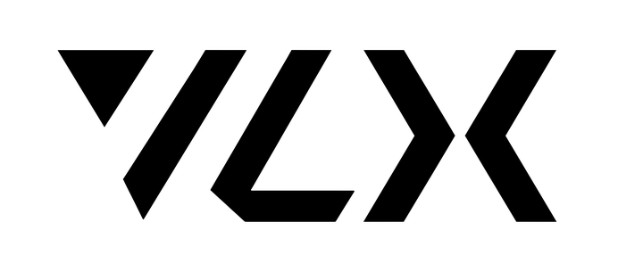
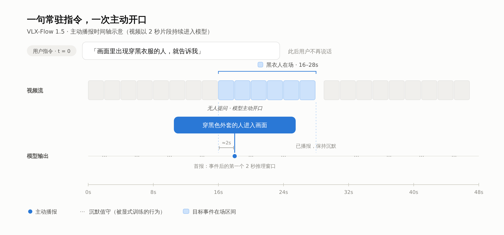
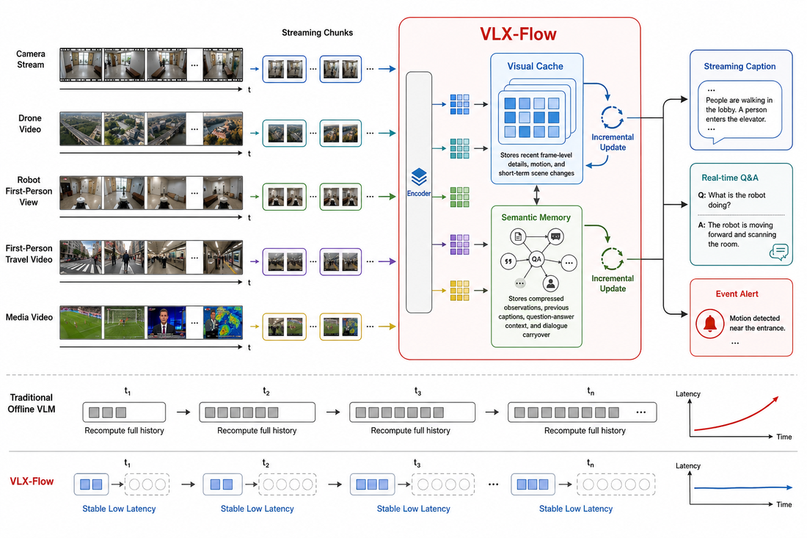
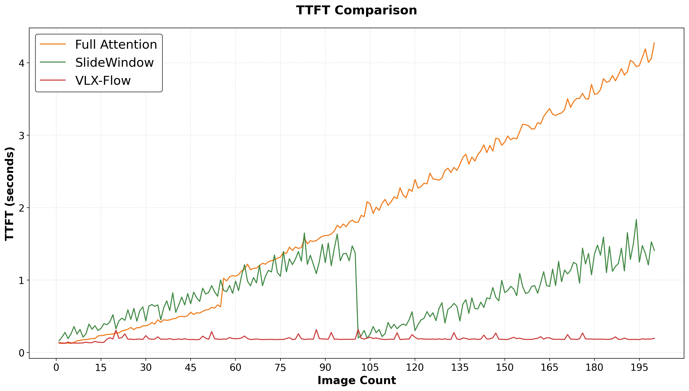
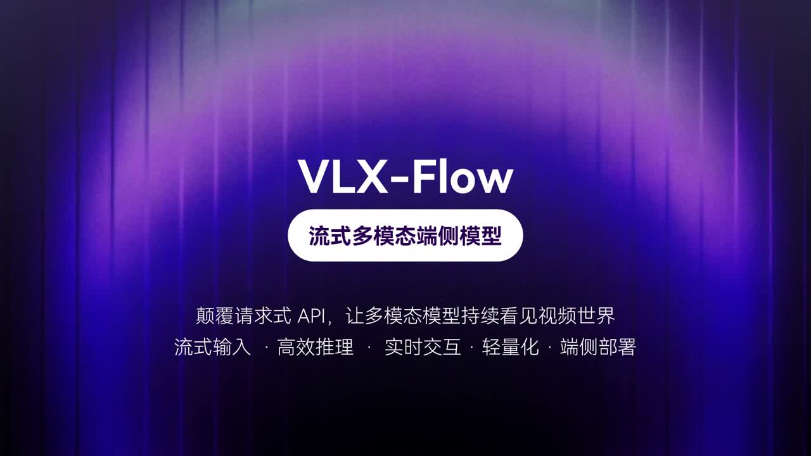

<a name="top"></a>

<p align="center">
  
</p>

<h1 align="center">VLX-Flow 1.5</h1>

<h3 align="center">面向端侧实时流式视频的主动响应增强</h3>

<p align="center">
  <a href="README.md">English</a> | 中文
</p>

<p align="center">
  <a href="https://om-ai-lab.github.io/2026_11_01_vlx_flow_1_5_zh.html">
    
  </a>
  <a href="https://om-agent.com">
    
  </a>
  <a href="https://x.com/OmAI_lab">
    
  </a>
  <a href="https://www.youtube.com/@OmAILab_global">
    
  </a>
  <a href="https://discord.gg/SEVNjyXPef">
    
  </a>
</p>

<p align="center">
  <a href="#highlights">更新亮点</a> &nbsp;·&nbsp;
  <a href="#proactive-demo">主动响应</a> &nbsp;·&nbsp;
  <a href="#api-examples">API 示例</a> &nbsp;·&nbsp;
  <a href="#benchmarks">评测结果</a> &nbsp;·&nbsp;
  <a href="#architecture">技术架构</a> &nbsp;·&nbsp;
  <a href="#community">社区</a>
</p>

---

<a name="overview"></a>

## 🌊 项目概览

VLX-Flow 是面向端侧实时视频的流式多模态模型，通过**连续视频输入、增量状态更新与双层记忆**，支持主动响应、持续描述和实时问答，为摄像头、机器人与屏幕助手提供持续更新的环境语义。

**VLX-Flow 1.5 延续已有流式架构，重点增强常驻指令下的事件触发与静默控制，并改善描述连贯性和问答的视觉依据。** 双层记忆与 Linear Attention 是已有架构基础，本次升级着重提升它们所支撑的连续交互能力。

<a name="highlights"></a>

## ✨ 1.5 更新亮点

- **🔔 更强的主动响应** — 根据一句自然语言常驻指令持续观察，优化目标事件出现时的响应、回复后的静默与重复输出控制。

- **🎬 更连贯的持续描述** — 加强跨片段语义衔接，让描述跟随场景变化，减少叙述割裂与重复。

- **💬 更注重视觉依据的实时问答** — 结合已有观察作答，信息不足时说明不确定性或合理拒答。

- **⚡ 按需输出的流式推理** — 在已有增量处理与状态复用基础上，通过静默控制减少冗余生成开销。

<a name="proactive-demo"></a>

## 🔔 主动响应示例

> 💬 **常驻指令**
>
> “画面里出现穿黑色外套的人就告诉我。”

模型持续观察视频，在指令条件满足时主动响应，随后恢复观察，等待后续符合条件的事件。

<p align="center">
  
  <br>
  <sub>交互流程示意：一次指令贯穿后续观察与事件响应。</sub>
</p>

<a name="capabilities"></a>

## 🎯 三项交互能力

### 🔔 主动响应

用户设定关注的事件后，模型结合指令条件、当前画面与已有回复记录，判断是否继续观察、主动响应或恢复静默。1.5 重点优化触发时机与输出节制，适用于按任务观察的摄像头和环境变化提醒等场景。

### 🎬 持续描述

模型随视频推进描述场景、主体与动作变化，并通过跨片段语义衔接保持时间线。例如，“拿起杯子 → 走向桌边 → 放下杯子”可形成连贯的观察上下文，为持续讲解和后续问答提供依据。

### 💬 实时问答

用户可在视频播放或摄像头运行过程中随时提问，模型基于已维护的观察上下文回答。1.5 强化视觉依据约束：例如，画面中没有出现船时，对“刚才那艘船往哪边开？”应指出未观察到船，避免无依据推测。

<a name="api-examples"></a>

## 📓 公开 API Notebooks

使用仓库自带的本地 MP4 调用线上 API。先通过基础版学习请求流程，再用进阶版交互体验同样的能力。

| Notebook | 内容 |
| --- | --- |
| [01 · API 基础](examples/notebooks/01_api_quickstart.ipynb) | 上传视频、设置指令、流式接收、会话内追问、停止，以及可选双路并行。 |
| [02 · 进阶交互](examples/notebooks/02_interactive_playground.ipynb) | 视频预览、参数调节、描述／检测指令切换、追问，以及两路独立分析结果展示。 |

安装与操作顺序见[示例说明](examples/README.md)，页面与 API 的对应关系见[进阶版工作原理](examples/docs/interactive_playground.md)。运行需要平台提供的 API 地址、访问令牌和模型权限；双路模式使用两个会话，不保证逐帧同步。上传由单元格显式执行，运行启动单元格或点击开始才会启动分析。

<a name="benchmarks"></a>

## 📊 评测摘要

以下展示 VLX-Flow 1.5 在三项公开基准上的核心质量指标。点击“完整对比”可查看技术博客中对应的模型对照表、分项结果与评测说明。

| 基准 / 任务 | 指标 | VLX-Flow 1.5 | 详细结果 |
| --- | --- | ---: | --- |
| 🎞️ StreamingBench Real-Time Visual | Overall | **85.00** | [完整对比 ↗](https://om-ai-lab.github.io/2026_11_01_vlx_flow_1_5_zh.html#:~:text=%E8%A1%A8%201.%20StreamingBench%20Real-Time%20Visual) |
| 🕒 OVO-Bench | Overall（三组宏平均） | **70.51** | [完整对比 ↗](https://om-ai-lab.github.io/2026_11_01_vlx_flow_1_5_zh.html#:~:text=%E8%A1%A8%202.%20OVO-Bench) |
| 💬 TraceBench v1.1 · 实时问答 | QA 准确率 | **76.5%** | [完整对比 ↗](https://om-ai-lab.github.io/2026_11_01_vlx_flow_1_5_zh.html#:~:text=%E8%A1%A8%203.%20TraceBench%20v1.1) |
| 🔔 TraceBench v1.1 · 主动响应 | 窗口内准确率 | **21.1%** | [完整对比 ↗](https://om-ai-lab.github.io/2026_11_01_vlx_flow_1_5_zh.html#:~:text=%E8%A1%A8%203.%20TraceBench%20v1.1) |

StreamingBench 与 OVO-Bench 采用与官方对齐的流式评测方式，问答模式每题平均查看 64 帧。各基准指标定义不同，分数应在各自基准内比较。

### 📍 引用 Trace

如果您觉得 [Trace](https://arxiv.org/abs/2609.30670) 有用，请使用以下 BibTeX 进行引用：

<details>
<summary>BibTeX</summary>

```bibtex
@misc{ma2026tracetemporalauditconditionaware,
  title={TRACE: Temporal Audit and Condition-aware Evaluation of Streaming Video Understanding},
  author={Yibo Ma and Qianqian Zhang and Peng Liu and Tiancheng Zhao},
  year={2026},
  eprint={2609.30670},
  archivePrefix={arXiv},
  primaryClass={cs.CL},
  url={https://arxiv.org/abs/2609.30670},
}
```

</details>

<a name="architecture"></a>

## 🧠 流式架构与行为训练

### 🗂️ 连续输入与双层记忆

VLX-Flow 按时间顺序处理连续视频片段：视觉编码器提取当前片段特征，语言主干结合已有状态进行增量推理，避免为每次交互重新处理完整历史。

- **视觉缓存：** 保留近期画面细节，支持即时问答与事件判断。
- **语义记忆：** 累积先前观察、持续描述和交互历史，维护跨片段上下文。

<p align="center">
  
  <br>
  <sub>1.5 延续的流式架构基础：连续观察、增量更新与持续记忆。</sub>
</p>

### ⚡ 状态复用与按需输出

语言主干中的 Linear Attention 模块通过可递推状态聚合历史信息，支持缓存复用，降低长视频交互中的重复计算与内存压力。1.5 进一步优化静默与响应行为，减少不必要的解码；视频观察仍持续进行。

<p align="center">
  
  <br>
  <sub>原版 Flow 技术介绍中的 TTFT 趋势图，用于说明架构背景；本图不是 1.5 的新增性能测试。</sub>
</p>

### 🎓 面向连续交互的行为训练

1.5 的流式行为监督将响应内容与逐轮交互状态对齐，包括是否满足指令条件、是否已回复以及是否应继续观察。配套 Streaming RL 基于 VLM-R1 的多模态强化学习范式，在完整流式回合中评价语义质量与响应时机，并比较多条响应轨迹，针对抢答、重复输出和漏答优化交互行为。

<a name="video"></a>

## 🎬 基础介绍视频

以下视频介绍原版 VLX-Flow 的连续视频理解能力；1.5 的更新请参阅上方亮点与技术博客。

<p align="center">
  <a href="https://www.youtube.com/watch?v=6XEpg83Fhsk">
    
  </a>
  <br>
  📺 高清版本：<a href="https://www.youtube.com/watch?v=6XEpg83Fhsk">在 YouTube 上观看</a>
</p>

架构背景：[原版中文博客](https://om-ai-lab.github.io/2026_06_26_vlx_flow_zh.html) · [原版 Hugging Face 博客](https://huggingface.co/blog/omlab/vlx-flow)

<a name="access"></a>

## 📦 仓库范围与访问

本仓库提供 VLX-Flow 的官方技术介绍、能力展示素材、评测摘要和公开 API 客户端示例。**模型训练与推理代码不对外开源。** 当前仓库不提供模型权重下载或本地部署包。

可通过 [VLX 平台](https://om-agent.com)了解和体验平台提供的能力；具体可用功能与模型版本以平台为准。本文的端侧定位描述模型的设计方向，本仓库不提供端侧部署工具。

欢迎提交文档修正、链接问题和使用反馈，详见[贡献说明](CONTRIBUTING.md)。

<a name="community"></a>

## 🤝 社区

加入 VLX 社区，与开发者交流，探索应用，分享反馈，共同塑造多模态 AI 的未来。

<table>
  <tr>
    <th align="center">官方微信</th>
    <th align="center">Discord 社区</th>
  </tr>
  <tr>
    <td align="center">
      
    </td>
    <td align="center">
      
    </td>
  </tr>
</table>

如需技术支持、商务合作或社区咨询，请联系：**[marketing@hzlh.com](mailto:marketing@hzlh.com)**

<p align="center">
  <a href="#top">↑ 返回顶部</a>
</p>
