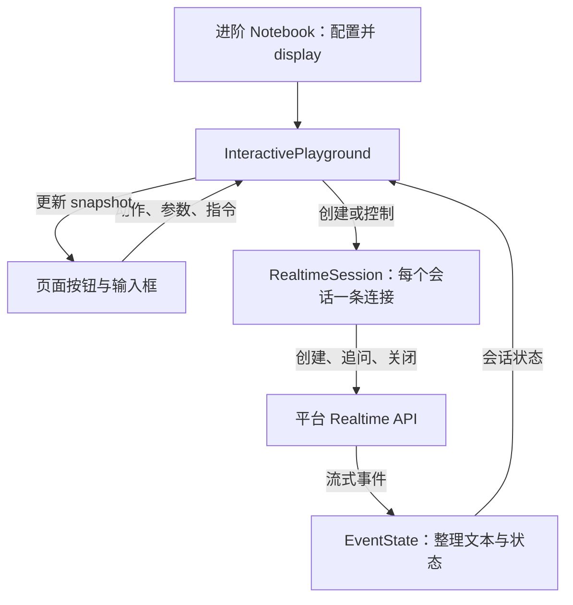
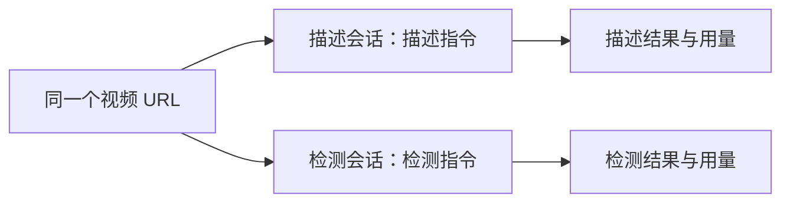

# 进阶版工作原理

[返回示例说明](../README.md) · [打开进阶 Notebook](../notebooks/02_interactive_playground.ipynb)

进阶版将基础版中“修改变量、运行启动、发送问题、运行停止”的操作变成控件。使用的仍是同一套 Realtime API。

## 从单元格到页面

第 1 步加载组件，第 2 步准备配置，第 3 步显式上传视频。第 4 步创建 `InteractivePlayground(...)` 并执行 `display(playground)`：读取本地视频用于预览，显示参数和按钮，登记按钮处理逻辑。首次打开页面不会创建模型会话。

如果重复运行第 4 步，代码会先关闭旧实例中的会话，再创建新页面；此时会恢复第 2 步的初始参数和指令。

| 页面操作 | 对应基础版操作 | API 行为 |
| --- | --- | --- |
| 选择任务、修改参数和指令 | 修改 Python 变量 | 编辑期间不调用模型 |
| 展开创建请求预览 | 查看 `session.create` JSON | 只显示预览，视频 URL 被隐藏 |
| 点击“开始分析” | 运行启动单元格 | 建立 WebSocket，发送 `session.create` |
| 发送追问 | 填写 `QUESTION` 并运行 | 在所选原连接内发送 `response.create` |
| 点击“全部停止” | 运行停止单元格 | 各连接发送 `session.close`，必要时用 REST DELETE 确认清理 |
| 到自动停止时限 | 基础版后台计时结束 | 进入相同的关闭流程 |

## 两个 Python 文件和界面文件的分工

| 文件 / 对象 | 负责什么 |
| --- | --- |
| [flow_api.py](../flow_api.py) / `RealtimeSession` | 一条连接对应一个会话：创建、后台接收、追问发送、计时与关闭。 |
| [flow_api.py](../flow_api.py) / `EventState` | 按回答 ID 拼接文本，区分分析和追问，处理重复事件、回答状态和 Token 用量。 |
| [flow_demo.py](../flow_demo.py) / `InteractivePlayground` | 接收页面动作，选择创建一路或两路会话，将它们的状态汇总给页面。 |
| [flow_player.js](../flow_player.js) | 显示控件和结果，将按钮动作发送给 Python 组件。 |
| [flow_player.css](../flow_player.css) | 控制组件的布局与样式。 |

组件通过 anywidget 在 Jupyter 中显示。安装 Python 依赖后即可运行，不需要额外启动网站服务或构建前端。

访问令牌和上传后的视频 URL 保存在 Python 内存中，API 请求由 Python 发出。浏览器组件接收本地预览视频和展示所需的状态；创建请求预览隐藏真实 URL。

## 三种持续任务与追问

**持续描述**创建一个会话，使用描述指令。**主动检测**也创建一个会话，使用条件检测指令。二者都将指令放进 `session.create.data.instruction`；页面的任务选项是客户端指令预设，不是额外的 API 模式参数。

**描述＋检测**创建两个独立会话，复用同一个已上传的视频 URL。两路共用页面下方的采样与生成参数，分别使用描述和检测指令，并保存各自的结果、状态与用量。

两路并行需要平台允许至少两个会话。它们独立处理和返回结果，可能存在启动或处理进度差异，不保证逐帧同步。如果一路运行失败，示例会通知另一条活动会话停止；仍需等待关闭确认。

**追问**是对已有会话的操作。首轮分析到达后，选择目标会话并发送问题；单路时只有一个目标，双路时可选择描述或检测会话。问题放在 `response.create.data.prompt`，不会新建会话，也不会停止持续分析。

持续分析事件为 `algorithm.analysis`，追问事件为 `algorithm.inquiry`。示例按 `response_id` 关联回答，允许回答早于 `command.result` 到达。每路同时只允许一条未完成追问，这是当前示例的交互限制。

## 页面上的时间分别代表什么

| 时间显示 | 来源 | 可以说明什么 |
| --- | --- | --- |
| 播放器进度 | 本地视频 `currentTime` | 浏览器当前播放的位置 |
| 每路底部 `xx / 60 秒` | 客户端任务启动后的已运行时长 | 该任务运行了多久；与基础版顶部计时属于同一类 |
| 回答旁 `服务端 xx` | 当前展示的有效回答携带的 `timestamp_ms / 1000` | 该条结果的服务端相对时间；尚未确认等于视频位置 |

主动检测后续如果返回空文本或省略号，页面会保留上一条有效结果及其时间，并增加折叠轮数。因此“描述 29 秒、检测 23 秒”不能单独证明检测处理落后 6 秒。两路真实进度是否有差异，需要结合原始事件和服务端时间字段的定义判断。

当前已观察到 `frameTime` 返回日期时间，客户端保留原值供诊断，不把它当作视频进度。暂停或拖动本地播放器不会控制服务端处理位置；发送追问也不会自动定位到本地当前帧。

## 停止、修改和排查

运行期间参数和持续指令会锁定。需要修改时先“全部停止”，等待各路关闭确认，修改后再次开始；只改这些设置无需重新上传视频。更换本地文件或鉴权信息则要重新执行配置和上传步骤。

进阶 Notebook 第 5 步是与页面按钮对应的备用停止入口。第 6 步按路读取最近的事件摘要，方便检查响应类型、回答 ID、时间和状态，不会再发起模型调用。

视频源报告 `completed` 时，尾部回答仍可能到达；示例会等待尾部输出，并在用户停止或达到时限时关闭。若显示“等待关闭确认”，先点击“检查关闭”或运行第 5 步，确认后再启动下一次。

默认提示词和视频对应关系、参数范围及安装步骤见[示例说明](../README.md)。公开字段定义以 [Realtime 文档](https://s.apifox.cn/46c7cae8-f2d7-4780-a960-e531d6c5eaa8/9598749m0)为准。
